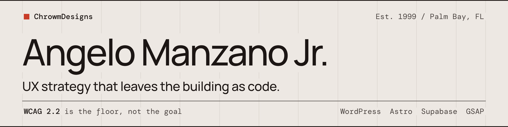

<picture>
  <source media="(prefers-color-scheme: dark)" srcset="assets/header-dark.png">
  
</picture>

**Senior UX strategist at [ChrowmDesigns](https://chrowmdesigns.com). Designer who ships code.**

The WCAG 2.2 audit on Basalio covered nine blocks plus a shared lightbox component. It turned up seven real defects across five modules. Every one is fixed in v0.5.1, and an automated PHP assertion suite now checks that they stay fixed, which matters more to me than the audit itself.

That's a fair picture of how ChrowmDesigns works. The studio has been running since 1999 as a UX strategy practice, with more than 20 years of work for clients like Disney, Marriott, EA, Beat Games and ESPN. These days, more of that strategy leaves the building as code I write myself.

---

## What's here

**Basalio** · v0.5.1
An accessibility-first WordPress block plugin for portfolio and case-study sites. Built for designers who want Semplice-level presentation without giving up keyboard users or screen readers to get it.

<!-- Pin your strongest 2 to 4 public repos and add a one-line entry for each here. -->

## How I work

Accessibility is the starting point, not a pass at the end. WCAG 2.2 is my baseline on every project, and the defects that matter usually live in the interaction layer: focus that disappears inside a modal, a lightbox that traps the keyboard, motion with no way to turn it off. Those don't show up in a screenshot review. They show up when you test.

Strategy comes first, though. Most of what I build starts as a Jobs-to-be-Done question about what the person on the other side of the screen is actually trying to get done.

## Tools I reach for

`WordPress block development` `PHP` `Astro` `Supabase` `Netlify` `GSAP` `Lenis` `Figma`

## Elsewhere

I also co-lead **Vice Alliance**, a design and engineering consultancy built around strategy, UX, branding and production for corporate clients. After hours, I make synthwave as **Max Overdrive 1986**.

**Work with me:** [chrowmdesigns.com](https://chrowmdesigns.com)
